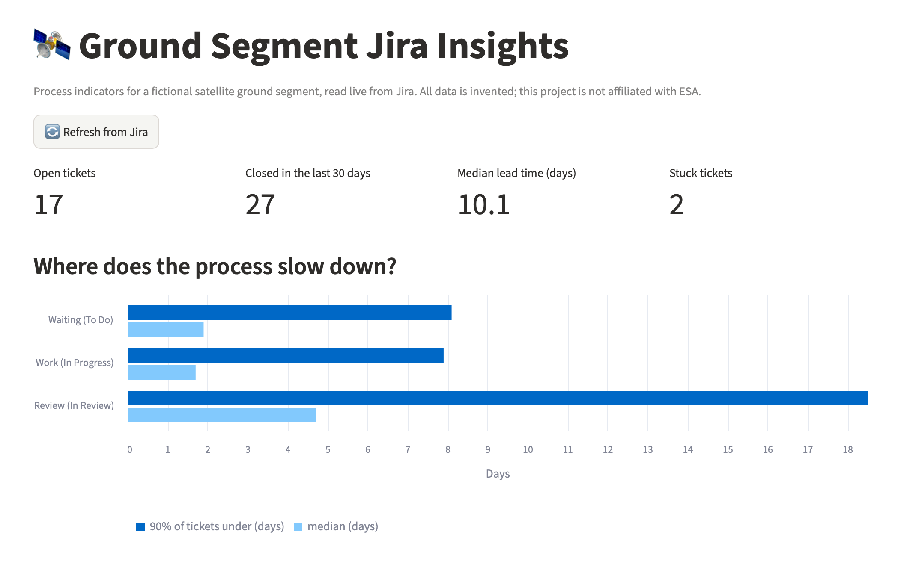

# 🛰️ Ground Segment Jira Insights

**A small tool that reads a Jira project, measures how well the team's process flows, and drafts a weekly status summary with a Large Language Model.**

👉 **Live app: [ground-segment-jira-insights.streamlit.app](https://ground-segment-jira-insights.streamlit.app)**



> All data is fictional. This is a personal project and is not affiliated with ESA, the Galileo programme or any other organisation.
> The app may take ~30 seconds to wake up if nobody has opened it recently.

## Context

Engineering teams that run a satellite ground segment (control centres, sensor stations, uplink stations…) track anomalies, change requests and actions in Jira. The question this tool answers is simple: **is the process flowing, and if not, where does it slow down?**

I worked on similar questions during a six-month internship in the Quality department of CNES at Europe's Spaceport, where I built anomaly KPIs and dashboards in VBA from Jira and Confluence data. This project does the same job with Python, a web dashboard and an LLM.

## What the dashboard shows

- **Headline indicators**: open tickets, tickets closed in the last 30 days, median lead time, stuck tickets.
- **Where the process slows down**: median and 90th percentile time spent in each workflow step (To Do → In Progress → In Review → Done). On the current data, the review step is the bottleneck.
- **Flow**: tickets created vs closed per month (is the backlog growing?).
- **Priorities**: median lead time per priority (are priorities respected?).
- **Tickets that need attention**: open tickets stuck in the same step for more than 10 days, with links to Jira.
- **AI weekly summary**: a short status report written by Google Gemini, downloadable as Markdown.
- **Filters** by subsystem, ticket type and priority. Every indicator and the AI summary follow the filters.

## How it works

```
fictional history (CSV) ─┐
                         ├─► jira_data.py ─► metrics.py ─► app.py (Streamlit dashboard)
Jira Cloud (REST API) ───┘    (pandas)        (KPIs)          └─► ai_summary.py (Gemini)
```

| File | Role |
|---|---|
| `generate_dataset.py` | Generates six months of fictional ground segment tickets (CSV) |
| `push_open_tickets.py` | Creates the still-open tickets in a real Jira Cloud project, with labels and statuses (no duplicates, checked with JQL) |
| `jira_data.py` | Reads Jira through its REST API (JQL search) and merges the live status with the history |
| `metrics.py` | Computes the process indicators with pandas |
| `ai_summary.py` | Builds a prompt from the indicators and asks Gemini for the weekly summary |
| `app.py` | The Streamlit web dashboard (Altair charts) |

## Design choices

- **Live Jira + CSV history.** Jira Cloud does not let a script back-date an issue, so six months of history are kept in a CSV file, while the open tickets live in a real Jira project. Jira is the source of truth: move a ticket on the Jira board, refresh the app, and the indicators follow.
- **Median rather than average.** A few tickets that wait for months would distort an average; the median and 90th percentile show the typical case and the difficult tail.
- **The numbers come from the code, the words from the AI.** The LLM never calculates anything: it only receives indicators already computed by `metrics.py` and is told to use nothing else. Its output is displayed tolerantly (formats vary from one answer to the next) and should always be checked before it is shared.
- **Secrets stay out of the code.** API keys are read from a `.env` file locally and from Streamlit secrets online; neither is published.

## Run it locally

```bash
git clone https://github.com/vdaydou/ground-segment-jira-insights.git
cd ground-segment-jira-insights
python3 -m venv .venv && source .venv/bin/activate
pip install -r requirements.txt
```

Create a `.env` file with `JIRA_URL`, `JIRA_EMAIL`, `JIRA_API_TOKEN`, `JIRA_PROJECT_KEY` and `GEMINI_API_KEY`, then run `streamlit run app.py`.

## About this project

Built by Vincent Daydou (École Centrale de Nantes / TU Munich) with AI-assisted development (Claude). I designed the indicators, the data model and the AI safeguards, and I can explain every part of the code.